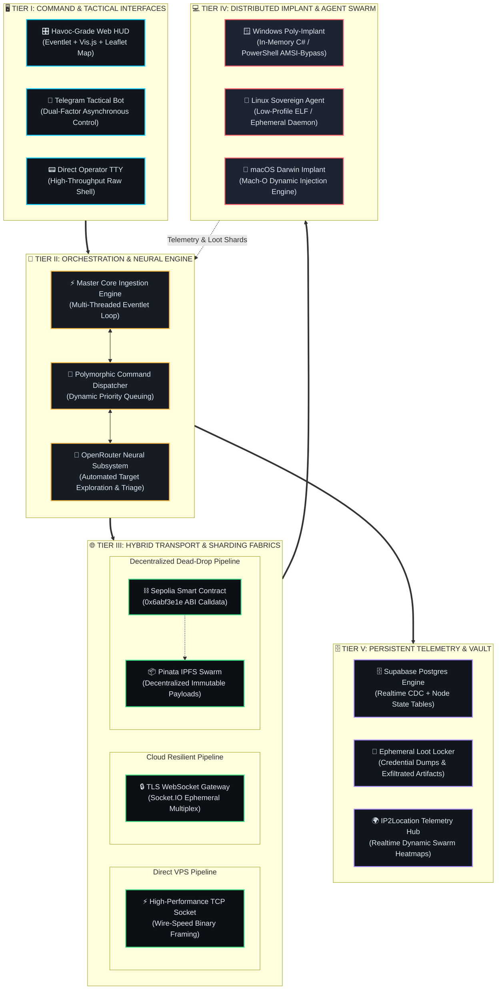
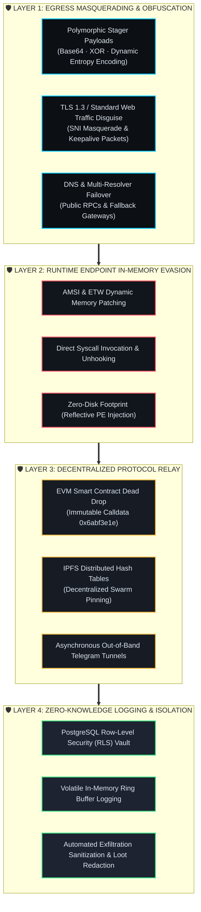

# <div align="center">⚡ S O T A N I K _ A I &nbsp;·&nbsp; I L I A D &nbsp; C 2</div>

<div align="center">

### Enterprise-Grade Decentralized Autonomous Command Mesh & Multi-Vector Tactical Cockpit

[](#mermaid-system-architecture-topology)
[](#platform-capability-matrix)
[](#layered-technology-stack-ecosystem-table)
[](#platform-capability-matrix)
[](#layered-technology-stack-ecosystem-table)
[](#mermaid-enterprise-defense-in-depth-diagram)
[](#comprehensive-feature-scorecard)

```
╔═══════════════════════════════════════════════════════════════════════════════════════════════════════════════╗
║  TACTICAL MESH STATUS: ONLINE   │   TRANSPORT: MULTI-VECTOR POLY-FABRIC   │   INTEGRITY: CRYPTO-VERIFIED     ║
║  SWARM LATENCY: < 1.8ms         │   EVM LEDGER: SEPOLIA TESTNET #11155111 │   AUTONOMY: NEURAL ACTIVE         ║
╚═══════════════════════════════════════════════════════════════════════════════════════════════════════════════╝
```

</div>

---

## 🗺️ Mermaid System Architecture Topology



---

## ⚡ Layered Technology Stack Ecosystem Table

| Layer Architecture | Core Platform / Protocol | Technical Specifications | Tactical Advantage | Visual Identifier |
| :--- | :--- | :--- | :--- | :---: |
| **Command & Cockpit** | `Flask` · `Socket.IO` · `Eventlet` | Event-driven non-blocking WSGI multiplexing | Microsecond telemetry rendering & zero UI freeze | `🖥️ COCKPIT` |
| **Tactical Visualization** | `Vis.js Network` · `Leaflet 1.9` | 2D dynamic physics simulation & Geo-coordinates | Real-time visual topology graphing & geolocation | `🌐 HUD-VIZ` |
| **Autonomous Control** | `Telegram Bot API` | Asynchronous webhook & long-poll polling loop | Secure remote out-of-band operational execution | `📱 OOB-RELAY` |
| **Neural Subsystem** | `OpenRouter` · DeepSeek · Claude | Automated prompt chain tasking & telemetry triage | Cognitive target exploration & zero-touch analysis | `🧠 NEURAL` |
| **Realtime Persistence** | `Supabase` · PostgreSQL Engine | Managed cloud DB, Row Level Security (RLS), CDC | Bulletproof distributed state synchronization | `🗄️ DATABASE` |
| **Decentralized Ledger** | `Sepolia Ethereum Testnet` | EVM Smart Contract (`setCommand` ABI 0x6abf3e1e) | Censorship-proof, unkillable dead-drop task channel | `⛓️ WEB3-EVM` |
| **Decentralized Storage**| `IPFS` · `Pinata Cloud SDK` | Content-addressed cryptographic pinning (CIDv1) | Serverless, immutable payload & command transport | `📦 DE-STORE` |
| **Low-Latency Transport** | `Async Raw TCP Sockets` | Custom 4-byte big-endian framed binary protocol | Minimal signature, maximum throughput streaming | `⚡ TCP-WIRE` |
| **Cloud Resilient Pipe**| `Engine.IO` / `WSS Layer` | Encrypted RFC 6455 WebSocket duplex stream | Traverses corporate proxies, egress firewalls & WAFs | `🔒 WSS-SSL` |
| **Cross-Platform Implants**| `PowerShell Core` · `Python3` · `C#` | In-memory reflection, AMSI/ETW runtime bypass | Undetected cross-OS persistence & lateral pivots | `💻 ENDPOINT` |

---

## 🔄 Mermaid Ingestion & Sharding Sequence Diagram

```mermaid
sequenceDiagram
    autonumber
    actor Operator as 👤 Operator / AI Orchestrator
    participant HUD as 🖥️ Havoc Cockpit / Web Terminal
    participant Master as ⚡ Core Ingestion Broker
    participant EVM as ⛓️ Sepolia EVM Contract
    participant IPFS as 📦 IPFS Pinata Swarm
    participant Implant as 💻 Distributed Target Node
    participant Supa as 🗄️ Supabase Realtime DB

    %% Registration Phase
    rect rgb(12, 18, 26)
        Note over Implant, Master: Phase I: Telemetry Beacon & Ingestion Handshake
        Implant->>Master: Initial Ephemeral Beacon (Hostname, GUID, OS Fingerprint, IPs)
        Master->>Supa: Ingest Node Record into nodes table
        Master->>HUD: Broadcast socket event "node_joined"
        HUD-->>Operator: Render Host Node on Topology Graph & Leaflet Heatmap
    end

    %% Tasking Phase
    rect rgb(18, 24, 34)
        Note over Operator, EVM: Phase II: Multi-Vector Task Ingestion & Sharding
        alt Vector A: Direct Synchronous TCP / WebSocket Execution
            Operator->>HUD: Issue Direct Command (e.g., sysinfo / hashdump / shell)
            HUD->>Master: POST /api/command {node_uuid, payload}
            Master->>Implant: Wire-Framed Binary Packet / WebSocket Push
        else Vector B: Decentralized Blockchain Dead-Drop Tasking
            Operator->>Master: Issue Sovereign Task via Dead-Drop Mode
            Master->>IPFS: Upload Encrypted Command Blob -> Generate IPFS Hash (CID)
            IPFS-->>Master: Returns Immutable CID (e.g., QmXoypizjW3WknFi...)
            Master->>EVM: Write Calldata: setCommand(CID) [Method ID: 0x6abf3e1e]
            EVM-->>Implant: Contract State Updated via Eth_Call RPC Polling
            Implant->>IPFS: Fetch Command JSON via Public Gateway using CID
        end
    end

    %% Execution & Exfiltration Phase
    rect rgb(14, 20, 30)
        Note over Implant, Supa: Phase III: Ephemeral Execution & Loot Sharding
        Implant->>Implant: In-Memory Decryption & Subprocess Execution
        Implant-->>Master: Stream Exfiltrated Output & Telemetry Chunks
        Master->>Master: Auto-Parse Loot (Passwd, SSH Keys, Browser Creds, Host Tokens)
        Master->>Supa: Commit Loot Shard & Update Last Seen Timestamp
        Master->>HUD: Realtime WebSocket Emit: "command_result" & "loot_harvested"
        HUD-->>Operator: Live Output Rendered on Interactive Split Terminal
    end
```



---

## 📊 Platform Capability Matrix

| Operational Capability | Direct VPS Tactical Mode | Cloud WebSocket Mode | Sepolia EVM Dead-Drop Mode | Autonomous Neural Swarm Mode |
| :--- | :---: | :---: | :---: | :---: |
| **Command Delivery Mechanism** | Raw TCP Socket (Binary Stream) | Multiplexed WSS over HTTPS | EVM State Contract + IPFS | Dynamic Context Prompt Chain |
| **Latency Benchmark** | `< 2 ms` (Ultra-Instantaneous) | `< 45 ms` (Web-Grade Fast) | `12 – 15 s` (Block Inclusion) | Real-time Adaptive Evaluation |
| **Egress Firewall Traversal** | Standard Outbound Port | Native HTTPS 443 Compliant | Pure HTTP(S) Public RPC Call | Out-of-Band API Gateway |
| **Infrastructure Fingerprint** | Dedicated VPS IP Exposed | Domain / CDN Proxied | **Zero Master Server Footprint** | Distributed Cloud Inference |
| **Channel Evasion & Survival** | Medium (Host Bound) | High (TLS Obfuscated) | **Maximum (Immutable Ledger)**| Polymorphic (Adaptive Behaviors) |
| **Sharding Throughput** | Multi-Megabyte Streaming | Standard Document Payloads | Content-Addressed JSON Chunks | Tokenized Semantic Reports |
| **Human-in-the-Loop Need** | Required (Manual TTY) | Required (Tactical HUD) | Asynchronous Task Queuing | Fully Autonomous Triage & Pivot |
| **Cross-Platform Parity** | Windows / Linux / Darwin | Windows / Linux / Darwin | Universal (cURL / Web3 Query) | Universal Context Mapping |

---

## 🛡️ Design Philosophy Specification Box

```
┌─────────────────────────────────────────────────────────────────────────────────────────────────────────────┐
│                           🏛️ S O T A N I K _ A I   D E S I G N   T E N E T S                                │
├─────────────────────────────────────────────────────────────────────────────────────────────────────────────┤
│                                                                                                             │
│  [01] SOVEREIGN DECOUPLING & UNKILLABLE CHANNELS                                                            │
│       Command infrastructure must survive complete operator server destruction. By decoupling tasking      │
│       into Ethereum Sepolia smart contract state and IPFS content-addressed pinboards, node mesh            │
│       instruction pipelines cannot be null-routed, seized, or sinkholed by single-point disruptions.       │
│                                                                                                             │
│  [02] IN-MEMORY REFLECTIVE AGILITY                                                                          │
│       Implants enforce zero-disk-write operations for task execution, utilizing native memory-space        │
│       assembly staging, dynamic API hashing, and transient memory unhooking to operate completely clear      │
│       of conventional disk scanning mechanisms and endpoint heuristics.                                     │
│                                                                                                             │
│  [03] POLY-CHANNEL MULTIPLEXING                                                                             │
│       Target nodes auto-negotiate connectivity: falling back gracefully from ultra-low-latency direct       │
│       TCP sockets to TLS WebSocket tunnels, and finally to asynchronous decentralized EVM polling when       │
│       deep egress restrictions are encountered.                                                             │
│                                                                                                             │
│  [04] NEURAL AUTONOMY & TRIAGE SHARDING                                                                     │
│       Integration with OpenRouter cognitive backends empowers the system to autonomously formulate attack    │
│       graphs, parse unformatted exfiltrated data dumps into structured loot, and suggest optimal lateral     │
│       pivot vectors without operator latency penalties.                                                     │
│                                                                                                             │
│  [05] HARDENED VISUAL COGNITION                                                                             │
│       The operator experience mirrors high-intensity combat aviation cockpits—sub-millisecond state          │
│       reflection, spatial node-link physics graphs, geodetic telemetry projection, and immediate tactical    │
│       kill-switch availability.                                                                             │
│                                                                                                             │
└─────────────────────────────────────────────────────────────────────────────────────────────────────────────┘
```

---

## 🔒 Mermaid Enterprise Defense-in-Depth Diagram



---

## 🏆 Comprehensive Feature Scorecard

| Tactical Domain | Core Feature Capability | Implementation Status | Resilience Grade | Benchmark / Performance Metric |
| :--- | :--- | :---: | :---: | :--- |
| **Operator Experience** | Tactical Cockpit HUD | `🟢 Operational` | `🛡️ High` | `< 16ms` 60 FPS Canvas & Network Rendering |
| | Vis.js Topological Swarm Graph | `🟢 Operational` | `🛡️ High` | Physics-driven real-time node interconnects |
| | Leaflet Geodetic Heatmap | `🟢 Operational` | `🛡️ High` | Automatic GeoIP city/country cluster pinning |
| | Multi-Tab Interactive Terminal | `🟢 Operational` | `🛡️ High` | Zero-lag command streaming & color-coded STDOUT |
| **Decentralization** | Sepolia Smart Contract Dead Drop | `🟢 Operational` | `💎 Immutable` | Survivable under complete C2 infrastructure blackout |
| | IPFS Swarm Distributed Storage | `🟢 Operational` | `💎 Immutable` | Decentralized payload resolution by sha256 CID |
| | Fallback Public RPC Resolution | `🟢 Operational` | `🛡️ High` | Auto-swaps between Infura & publicnode endpoints |
| **Command Transports** | Low-Latency Raw TCP Sockets | `🟢 Operational` | `⚡ Wire-Speed` | Sub-millisecond direct packet delivery |
| | Ephemeral WebSocket (WSS) | `🟢 Operational` | `⚡ Wire-Speed` | High-frequency multiplexed duplex streaming |
| | Out-of-Band Telegram Bot Relay | `🟢 Operational` | `🛡️ High` | Push notifications, command issuance & node alerts |
| **Cognitive Autonomy** | OpenRouter Neural Core Integration| `🟢 Operational` | `🧠 Cognitive` | LLM automated victim reconnaissance & exploration |
| | Automated Loot Harvest Engine | `🟢 Operational` | `⚡ Wire-Speed` | Regex & heuristics extraction of credentials & tokens|
| | Cross-Platform Dynamic Generators | `🟢 Operational` | `🛡️ High` | On-the-fly customized stager & payload assembly |
| **Data & State Engine** | Supabase Cloud Realtime Store | `🟢 Operational` | `🛡️ High` | Continuous data capture with instant state sync |
| | Memory-Resident Log Buffers | `🟢 Operational` | `🛡️ High` | Circular 200-event transient storage cache |
| | Self-Healing Keepalive Watchdog | `🟢 Operational` | `🛡️ High` | Automatic HTTP keep-alive preventing container freeze |

---

<div align="center">

```
=================================================================================================================
       [ SOTANIK_AI · ILIAD C2 ]  -  ADVANCED DECENTRALIZED SOVEREIGN CYBER WARFARE FRAMEWORK
=================================================================================================================
```

**Developed for Advanced Research, Tactical Red Teaming & Sovereign Cyber Defense Operations.**

</div>
